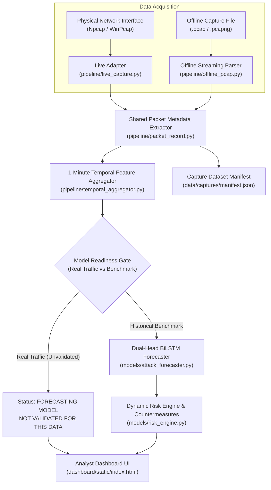

# AI-Based Network Attack Forecasting System
### Smart India Hackathon (SIH) Problem Statement ID: **SIH26153**
> **"AI based Network Attack Forecasting from Network Traffic Data"**

An intelligent cybersecurity defense system that forecasts the most probable **NEXT stage** of a multi-stage cyber attack before it is confirmed. By moving from purely reactive detection to proactive probabilistic forecasting, security teams can implement automated, non-disruptive preventive controls before an attacker executes an intrusion or establishes persistence.

---

## Table of Contents
1. [Core Features](#core-features)
2. [Prerequisites & Installation](#prerequisites--installation)
3. [How to Run the Application](#how-to-run-the-application)
4. [Using the Analyst Dashboard](#using-the-analyst-dashboard)
5. [Training & Testing](#training--testing)
6. [System Architecture & 6-Step Pipeline](#system-architecture--6-step-pipeline)
7. [API Endpoints Reference](#api-endpoints-reference)
8. [Dataset Balancing Note](#dataset-balancing-note)
9. [Project Directory Structure](#project-directory-structure)

---

## Core Features

- **Multi-Stage Attack Progression**: Models the conceptual progression:
  $$\text{Reconnaissance} \longrightarrow \text{Scanning} \longrightarrow \text{Enumeration} \longrightarrow \text{Exploitation} \longrightarrow \text{Intrusion}$$
  Tolerates pauses (benign background traffic), retries, and behavioral variations.
- **Dual-Head BiLSTM Neural Network**: 
  - **Head 1 (Current Classifier)**: Classifies the active attack phase.
  - **Head 2 (Next-Stage Forecaster)**: Predicts the probability distribution over candidate next stages conditioned on temporal sequences ($T=10$).
- **Dynamic Risk Engine (0–100)**: Combines sequence forecast probability, phase transition severity weight, and anomalous flow density into categorical risk levels (`LOW`, `MEDIUM`, `HIGH`).
- **Explainable AI (SHAP GradientExplainer)**: 
  - Top feature attribution rankings identifying exact behavioral risk drivers.
  - Force-plot contribution view decomposing baseline vs. forecast probability.
- **Ranked Non-Blocking Defensive Countermeasures**: Generates 2–4 prioritized mitigation actions with explicit feature-based rationales citing top SHAP risk drivers (e.g., port diversity, fanout rate, packet rate).
- **Dual Ingestion Modes**:
  - **Synthetic Flow Stream**: Chronologically advances simulated multi-stage attack scenarios.
  - **Real CICIDS2017/2018 Ingestion**: Automatically windowed playback through actual network flow CSV data.
- **Excel (.xlsx) Export Engine**: One-click download of all session forecasts formatted with `openpyxl` (frozen headers, Arial typography, auto-sized columns, conditional risk color fills, and no formula errors).

---

## Prerequisites & Installation

### 1. Requirements
- **Python 3.10, 3.11, 3.12, or 3.13**
- Windows, macOS, or Linux

### 2. Clone or Navigate to the Repository
```bash
cd sih
```

### 3. (Recommended) Create and Activate a Virtual Environment
- **Windows (PowerShell)**:
  ```powershell
  python -m venv venv
  .\venv\Scripts\Activate.ps1
  ```
- **macOS / Linux**:
  ```bash
  python3 -m venv venv
  source venv/bin/activate
  ```

### 4. Install Dependencies
```bash
pip install -r requirements.txt
```

---

## How to Run the Application

### Option A: Quickstart (Recommended)
Run the launcher script:
```powershell
python run_demo.py
```
This starts the local FastAPI server and hosts the security dashboard.

### Option B: Using Uvicorn Directly
You can run the server directly with live-reloading enabled for development:
```powershell
python -m uvicorn dashboard.server:app --host 127.0.0.1 --port 8000 --reload
```

### Accessing the System
Once the server is running:
- **Analyst Dashboard**: Open [http://localhost:8000](http://localhost:8000) or [http://127.0.0.1:8000](http://127.0.0.1:8000) in any web browser.
- **Interactive API Docs (Swagger / OpenAPI)**: Open [http://localhost:8000/docs](http://localhost:8000/docs).

---

## Using the Analyst Dashboard

The web dashboard is built for security analysts and SOC teams:

1. **Exact Output Banner**:
   Displays the required SIH output specification in real time:
   ```
   Current: Scanning → Predicted Next: Enumeration → Confidence: 87% → Risk: HIGH
   ```
2. **Conceptual Attack Progression (Step Indicator)**:
   - Visually indicates all 5 stages horizontally.
   - Nodes indicate `CURRENT ACTIVE` (blue pulse glow), `FORECASTED NEXT` (dashed border), and `PASSED`.
   - The connector highlight bar dynamically lights up across completed steps and links to the next forecasted phase.
3. **Live Stream Advancement (`Advance Flow Stream` button)**:
   - Click to step through sequential windows of the synthetic multi-stage attack timeline.
   - Watch the active stage advance through Reconnaissance $\rightarrow$ Scanning $\rightarrow$ Enumeration $\rightarrow$ Exploitation $\rightarrow$ Intrusion.
4. **Real Data Playback (`Load Real CICIDS Sample` button)**:
   - Ingests real CICIDS2017 flow data (`data/sample_cicids2017.csv`).
   - Automatically walks through sliding $T=10$ windows with smooth 1.4s animated playback.
5. **Export to Excel (`Export to Excel` button)**:
   - Click to generate and download a `.xlsx` report containing every forecast generated during your session.
6. **Explainable AI (SHAP Module Tabs)**:
   - **Feature Rankings**: Displays the top 12 flow features ranked by absolute SHAP impact with positive/negative direction.
   - **Force View**: Interactive force bars showing base probability vs. model forecast.
7. **Ranked Preventive Responses**:
   - Provides prioritized security controls (Priority 1, 2, 3) citing specific feature anomalies.

---

## Training & Testing

### 1. Retrain the BiLSTM Model
To regenerate the synthetic training dataset, fit the feature scaler, and train the dual-head BiLSTM from scratch:
```powershell
python train.py
```
This outputs:
- Model weights: `models/bilstm_weights.pt`
- Feature scaler: `pipeline/scaler.pkl`
- Background samples for SHAP: `pipeline/background_samples.npy`

### 2. Run Automated Unit & Integration Tests
Execute the full pytest test suite:
```powershell
python -m pytest tests/test_pipeline.py -v
```
The test suite validates:
1. Feature extraction from raw network flows (12 features across 6 categories).
2. Temporal sequence construction ($T=10$ sliding windows).
3. Dual-head BiLSTM forward pass and probability constraints ($\sum p = 1.0$).
4. Dynamic Risk Engine calculations and categorical thresholds.
5. SHAP `GradientExplainer` attribution rankings and force-plot structures.
6. FastAPI endpoints (`/api/forecast`, `/api/stream`).
7. Real CICIDS2017/2018 CSV parsing and `/api/ingest-real`.
8. Dynamic windowed streaming and feature-rationalized defenses.
9. Excel export workbook schema, frozen panes, formatting, and formula integrity.
10. Synthetic dataset equal-per-stage balancing.

---

## Wireshark Integration & Packet Processing Guide

### 1. Capturing a PCAPNG Sample with Wireshark
To capture a real network traffic trace for analysis:
1. Open **Wireshark** with Administrator privileges.
2. Select your active network adapter (e.g., `Ethernet` or `Wi-Fi`).
3. (Optional) Set a capture filter (e.g., `tcp or udp or icmp`) to focus on transport traffic.
4. Click **Start Capturing Packets** (the blue shark fin icon).
5. Generate normal network activity (or execute controlled lab test traffic).
6. Click **Stop Capture** (the red square icon).
7. Go to **File → Save As...** and save the file with the extension `.pcapng` or `.pcap` (e.g., `capture_sample.pcapng`).

### 2. Processing an Existing Capture
You can process PCAPs either through the Analyst Dashboard or via the REST API:
- **Web UI**: Navigate to the Analyst Dashboard at `http://localhost:8000`. In the **PCAP File Ingestion** panel, select your `.pcap` or `.pcapng` file and click **Upload & Dissect Capture**.
- **REST API (PowerShell)**:
  ```powershell
  Invoke-RestMethod -Uri "http://localhost:8000/api/capture/upload-pcap" -Method Post -InFile "C:\path\to\capture.pcapng" -ContentType "application/vnd.tcpdump.pcap"
  ```
The offline parser (`pipeline/offline_pcap.py`):
- Verifies PCAP/PCAPNG magic byte headers.
- Streams packet parsing via `scapy.utils.PcapReader` (avoiding loading full captures into memory).
- Extracts actual packet timestamps, frame lengths, protocols, addresses, ports, and TCP flags.
- Aggregates packets into discrete 1-minute temporal windows (`pipeline/temporal_aggregator.py`).
- Registers the capture metadata and quality metrics in `data/captures/manifest.json`.

### 3. Starting & Stopping Live Capture
- **Web UI**: In the **Live Network Packet Capture** panel, select an enumerated network interface from the dropdown and click **Start Real Capture**. Click **Stop Capture** at any time to halt packet sniffing and release socket resources.
- **REST API (PowerShell)**:
  ```powershell
  # Check available interfaces
  Invoke-RestMethod -Uri "http://localhost:8000/api/capture/interfaces" -Method Get

  # Start live capture on selected interface
  Invoke-RestMethod -Uri "http://localhost:8000/api/capture/start" -Method Post -Body (@{ interface = "\Device\NPF_{...}"; capture_method = "live_sniff" } | ConvertTo-Json) -ContentType "application/json"

  # Poll capture feed and 1-minute aggregated windows
  Invoke-RestMethod -Uri "http://localhost:8000/api/capture/feed" -Method Get

  # Stop live capture
  Invoke-RestMethod -Uri "http://localhost:8000/api/capture/stop" -Method Post
  ```

### 4. Npcap and Administrator Permission Requirements
- **Npcap Driver**: Real-time packet sniffing on Windows requires [Npcap](https://npcap.com/) (installed with the option **"Install Npcap in WinPcap API-compatible Mode"**).
- **Administrator Privileges**: Raw socket sniffing on network interfaces requires elevated privileges. Run your terminal or PowerShell console as **Administrator**.
- **Truthful Error Handling**: If Npcap or elevated privileges are absent, the system does **not** fall back to synthetic packets. It explicitly reports `MONITOR NOT DETECTED` or `INSUFFICIENT PERMISSIONS` in compliance with operational honesty rules.

---

## Conceptual Architecture: Capture vs. Detection vs. Forecasting

It is critical to distinguish between the three distinct layers of network security analytics:

| Operational Layer | Focus | Data Source | Latency / Scope | Readiness State in System |
| :--- | :--- | :--- | :--- | :--- |
| **Packet Capture** | Real-time observation of network frames | Network interface (Npcap) or PCAP file | Millisecond frame arrival | Fully implemented with streaming parsing & 1-min aggregation |
| **Attack Detection** | Classifying ongoing anomalous patterns | Current flow or frame window | Immediate / reactive | Operational on labeled benchmarks; real packets marked `UNLABELED` |
| **Attack Forecasting** | Predicting the *next probable attack stage* | Sequence of validated temporal windows ($T=10$) | Proactive / forward-looking | **Gated:** Displays `FORECASTING MODEL NOT VALIDATED FOR THIS DATA` for real traffic |

### Strict Model Readiness Gating (Phase G)
The pre-existing BiLSTM production weights (`models/bilstm_weights.pt`) and scaler (`pipeline/scaler.pkl`) were fitted on synthetic Gaussian progression timelines. They have **not** been trained or validated on the real-world 13-feature 1-minute packet aggregations. 

In strict adherence to scientific evaluation guidelines:
1. Real packet captures (live or PCAP) will **not** invoke the legacy synthetic BiLSTM model.
2. The API and UI truthfully report:
   ```json
   {
     "status": "FORECASTING MODEL NOT VALIDATED FOR THIS DATA",
     "prediction_available": false,
     "model_readiness": "NOT_VALIDATED_FOR_REAL_DATA",
     "reason": "Empirical temporal sequence model must be trained on authentic labeled temporal PCAP data before forecasting can be enabled."
   }
   ```
3. Packet telemetry, raw metrics, protocol ratios, and 1-minute window temporal aggregations remain fully operational.

---

## Known Limitations & Remaining Work

1. **Model Validation on Real Temporal PCAP Data**: The Dual-Head BiLSTM requires training on verified multi-stage attack PCAPs with timestamp-grounded progression before live forecasting can be activated.
2. **Wi-Fi Promiscuous Mode**: In Windows environments, capturing packets across third-party devices on a Wi-Fi network requires monitor mode or mirror port configuration (SPAN) on network switches.
3. **Encrypted Payloads**: Deep packet inspection does not decrypt TLS/HTTPS traffic; feature extraction relies strictly on layer 3/4 headers, timing, packet sizes, and flag metadata.

---

## System Architecture & Pipeline



---

## API Endpoints Reference

| Method | Endpoint | Description |
| :--- | :--- | :--- |
| `GET` | `/` | Serves the interactive analyst dashboard UI |
| `GET` | `/api/capture/interfaces` | Returns detected host network interfaces |
| `POST` | `/api/capture/start` | Starts live network traffic capture (`live_sniff`) |
| `POST` | `/api/capture/stop` | Stops live packet capture and releases socket resources |
| `POST` | `/api/capture/clear` | Clears packet history buffers and resets sliding baseline |
| `GET` | `/api/capture/status` | Returns truthful live capture engine status and metrics |
| `GET` | `/api/capture/feed` | Delivers real-time packet feed, sliding window features, and gated prediction |
| `POST` | `/api/capture/upload-pcap` | Dissects uploaded `.pcap`/`.pcapng` packet capture via streaming Scapy parser |
| `GET` | `/api/capture/temporal-windows` | Retrieves computed 1-minute discrete aggregated temporal windows |
| `GET` | `/api/captures/manifest` | Returns manifest of all imported offline captures |
| `GET` | `/api/soc/overview` | Aggregated SOC operational health and capture metrics |
| `POST` | `/api/forecast` | Forecasts for provided sequence (gated if real data) |
| `GET` | `/docs` | Interactive Swagger/OpenAPI documentation |

---

## Project Directory Structure

```
AI-based-Network-Attack-Forecasting-from-Network-Traffic-Data-main/
├── dashboard/
│   ├── server.py                   # FastAPI server, REST routes & readiness gating
│   └── static/
│       ├── index.html              # Cleaned analyst dashboard UI (zero fake streams)
│       ├── style.css               # Design system, CSS variables & layouts
│       └── app.js                  # Frontend state management & live charts
├── data/
│   ├── captures/                   # Real offline & live PCAP captures and manifest
│   │   └── manifest.json           # Capture provenance, packet counts, duration
│   └── benchmark/temporal/         # Preserved historical research artifacts
├── models/
│   ├── attack_forecaster.py        # Dual-Head PyTorch BiLSTM neural network
│   ├── bilstm_weights.pt           # Preserved production model weights (unmodified)
│   ├── risk_engine.py              # Dynamic risk engine & defensive mitigations
│   └── shap_explainer.py           # Feature attribution engine
├── pipeline/
│   ├── packet_record.py            # Shared metadata schema & Scapy packet parser
│   ├── offline_pcap.py             # Streaming PCAP/PCAPNG validator and parser
│   ├── temporal_aggregator.py      # 1-minute discrete temporal feature aggregator
│   ├── capture_manifest.py         # Capture dataset registry & audit logging
│   ├── live_capture.py             # Npcap/Scapy live sniffer with truthful states
│   ├── feature_extractor.py        # 12-feature legacy behavioral extractor
│   ├── real_flow_loader.py         # CICIDS2017/2018 CSV parser
│   └── scaler.pkl                  # Preserved StandardScaler (unmodified)
├── tests/
│   ├── test_offline_capture.py     # Offline PCAP validation & parsing tests
│   ├── test_live_capture_real.py   # Live capture lifecycle & truthful state tests
│   ├── test_temporal_aggregation.py# 1-minute window temporal aggregation tests
│   ├── test_model_gating_real.py   # Model readiness gating & unvalidated state tests
│   └── test_pipeline.py            # Core pipeline and legacy benchmark tests
├── README.md                       # System documentation & usage guide
├── requirements.txt                # Python package dependencies
└── run_demo.py                     # One-click application launcher
```

