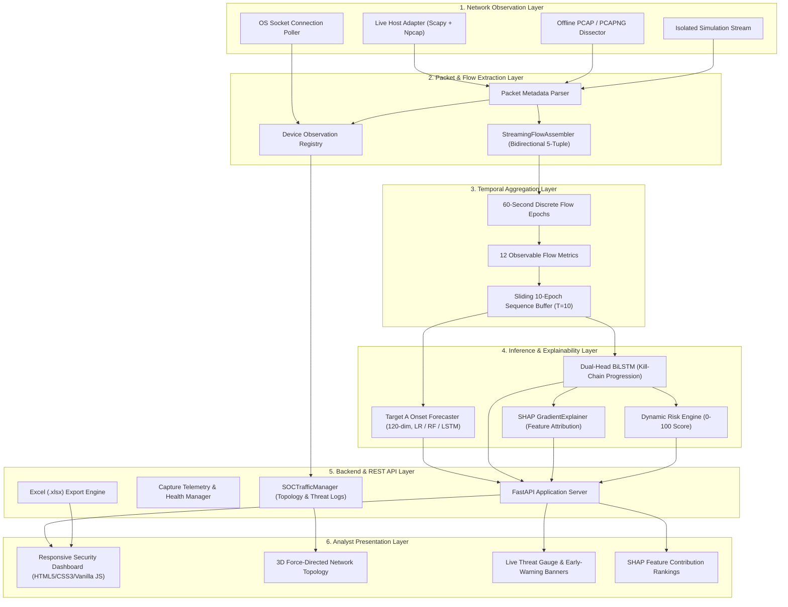

# System Architecture & Technical Specification

**Project:** AI-Based Network Attack Forecasting System (SIH26153)  
**Document Version:** 2.1-Production  
**Target Environment:** Windows 10/11, Python 3.10–3.13, Scapy + Npcap  

---

## 1. High-Level Architecture Overview

The system operates across six decoupled layers that transition network data from raw packet observation into probabilistic, defensible early warnings.



---

## 2. Ingestion & Observation Layer

The application supports four isolated ingestion modes, strictly segregated to eliminate cross-mode contamination:

### 2.1 Mode 1: Live Network Sniffing (`live`)
- **Backend**: Scapy packet sniffer leveraging Npcap in WinPcap-compatible mode on Windows.
- **Interface Selection**: Discovers all physical, virtual, and loopback host adapters via Windows GUID, adapter name, and IPv4/IPv6 assignments.
- **Safety Policy**: Operates in non-promiscuous or promiscuous mode based on adapter capabilities. Dropped malformed packets are incremented in telemetry counters without crashing sniffer threads.
- **Health Gating**: Verifies Npcap DLL existence (`wpcap.dll`, `Packet.dll`) and kernel service execution (`sc query npcap`) prior to starting.

### 2.2 Mode 2: Offline PCAP Dissection (`pcap`)
- **Backend**: `OfflinePcapProcessor` reading raw `.pcap` or `.pcapng` files.
- **Timestamp Fidelity**: Preserves original packet arrival timestamps ($t_{\text{packet}}$) rather than assigning real-world ingestion time. Enables reproducible historical playback.
- **Manifest Provenance**: New captures are recorded in `data/captures/manifest.json` with duration, total packets, total bytes, SHA256 hashes, and parsing verification status.

### 2.3 Mode 3: Connection Metadata Poller (`connection_metadata`)
- **Backend**: System socket inspection querying active TCP/UDP connections via OS network tables.
- **Truth in Advertising**: Explicitly labeled as OS connection polling rather than deep packet capture.

### 2.4 Mode 4: Testing Simulation Stream (`simulation`)
- **Backend**: Programmatic scenario generator advancing synthetic attack timelines.
- **Strict Quarantine**: Observations in simulation mode write exclusively to `_sim_registry` in `DeviceObservationRegistry`. Topology, threat logs, and metrics are isolated from real data.

---

## 3. Flow Extraction & Bidirectional Assembly Layer

Continuous packet streams are assembled into stateful bidirectional flows by `StreamingFlowAssembler`:

### 3.1 Flow Key Definition & Canonicalization
A flow is identified by its canonical 5-tuple:
$$\text{Key} = \left( \min(IP_{\text{src}}, IP_{\text{dst}}), \text{Port}_1, \max(IP_{\text{src}}, IP_{\text{dst}}), \text{Port}_2, \text{Protocol} \right)$$
- Preserves forward vs. reverse packet direction to compute asymmetric statistics (forward packet count, reverse byte volume).
- Reverse mappings are stored in `_reverse_map` to route inbound response packets to their originating active flow.

### 3.2 Protocol & Header Support
- **IPv4 & IPv6**: Normalized address parsing, stripping bracket notations and CIDR suffixes.
- **TCP**: SYN, FIN, RST, ACK, PSH flag extraction. Detects connection handshake and teardown.
- **UDP**: Stateless flow assembly with configurable inactivity timeout ($T_{\text{idle}} = 60\text{ s}$).
- **ICMP / ICMPv6**: Type and code tracking; directional echo-request / echo-reply association.
- **Non-IP Packets**: ARP frames and link-layer discovery packets update the `DeviceObservationRegistry` but do not generate IP transport flows.

### 3.3 Resource Bounding & Memory Safety
- Maximum active flow table size: `max_active_flows = 10,000`.
- Oldest inactive flows are pruned using LRU semantics when capacity is reached.
- Flows with TCP FIN or RST flags are finalized and archived into the active epoch.

---

## 4. Temporal Aggregation Layer

### 4.1 60-Second Discrete Epoch Boundaries
Continuous flows are attributed to 1-minute discrete temporal windows:
$$\text{Epoch Floor} = \lfloor t_{\text{flow\_start}} / 60 \rfloor \times 60$$

### 4.2 The Canonical 12 Observable Flow Metrics
For each completed 1-minute epoch, exactly 12 deterministic metrics are computed:

| # | Metric Identifier | Calculation / Unit | Purpose |
| :- | :--- | :--- | :--- |
| 1 | `flow_count` | Total active flows in epoch (count) | Density & connection intensity |
| 2 | `total_packets` | Total packet volume across all flows | Volumetric throughput |
| 3 | `total_bytes` | Total byte volume across all flows | Bandwidth demand |
| 4 | `mean_flow_duration_ms` | Mean of flow longevities (ms) | Persistence vs. ephemeral scanning |
| 5 | `std_flow_duration_ms` | Standard deviation of flow longevities | Flow uniformity |
| 6 | `tcp_flow_ratio` | $\text{Count}(\text{TCP}) / \text{Total Flows}$ | Protocol distribution |
| 7 | `udp_flow_ratio` | $\text{Count}(\text{UDP}) / \text{Total Flows}$ | Protocol distribution |
| 8 | `dst_port_diversity` | Unique destination ports contacted | Horizontal vs. vertical scanning |
| 9 | `dst_port_entropy` | Normalized Shannon entropy of port distribution | Port dispersion metric |
| 10 | `distinct_src_ips` | Unique transmitting IP addresses | Distributed vs. single-source activity |
| 11 | `distinct_dst_ips` | Unique target IP addresses | Fanout & sweep detection |
| 12 | `syn_flag_ratio` | $\text{Packets with SYN} / \text{Total Packets}$ | Reconnaissance probe density |

### 4.3 Empty Epoch Handling
When network traffic ceases during an epoch:
- The assembler generates an explicit empty epoch (`is_empty=True`).
- All 12 metrics are zeroed.
- Prevents missing-minute drift and avoids synthetic data interpolation.

---

## 5. Dual Modeling Subsystems

### 5.1 Subsystem A: Target A Real-Data Attack-Onset Forecaster
Designed for empirical early-warning forecasting on authentic traffic:

```
[ t-9 ................... t ]  [ t+1 ... t+2 ]  [ t+3 ................... t+7 ]
<-- Clean History (10m) --->  <-- Lead Gap -->  <--- Forecast Horizon (5m) --->
     Zero Attack Flows           Zero Attack        Target: Attack Onset Here
```

- **Input Dimension**: $10 \times 12 = 120$ continuous dimensions.
- **Preprocessing**: `StandardScaler` fit exclusively on training data ($N=1,117$).
- **Models Available**:
  - `model.joblib`: Balanced Logistic Regression (Primary production candidate).
  - `random_forest.joblib`: Random Forest Classifier (Depth 6, 100 estimators).
  - `compact_lstm.pt`: 1-Layer PyTorch LSTM (Sequence tensor $N \times 10 \times 12$).
- **Gating**: Strictly checks input shape and rejects raw packet features with HTTP 422. Returns `INSUFFICIENT_HISTORY` if fewer than 10 completed epochs exist.

### 5.2 Subsystem B: Dual-Head BiLSTM Kill-Chain Classifier & Forecaster
Designed for conceptual multi-stage kill-chain tracking, risk scoring, and countermeasure recommendation:
- **Head 1**: Predicts current active attack stage among:
  $$\text{Reconnaissance} \longrightarrow \text{Scanning} \longrightarrow \text{Enumeration} \longrightarrow \text{Exploitation} \longrightarrow \text{Intrusion}$$
- **Head 2**: Computes transition probability vector for the candidate next attack stage.
- **Dynamic Risk Engine**: Combines sequence transition probability, stage severity weight ($W_{\text{recon}}=0.2 \dots W_{\text{intrusion}}=1.0$), and anomalous flow density into a composite risk score (0–100) mapped to `LOW`, `MEDIUM`, or `HIGH`.
- **Explainable AI (SHAP)**: Uses PyTorch `GradientExplainer` against a baseline background distribution ($N=50$) to produce top feature attribution rankings (e.g., port diversity, fanout, SYN ratio).
- **Automated Countermeasures**: Synthesizes 2–4 prioritized defensive recommendations with explicit technical rationales citing top SHAP feature drivers.

---

## 6. Device Registry & Network Topology

### 6.1 DeviceObservationRegistry
- Maintains observed endpoint inventories mapped by IP address.
- Tracks verified attributes: MAC address, host vendor (via OUI lookup), discovered hostnames, open service ports, observation count, first-seen timestamp, and last-seen timestamp.
- Segregated into independent dictionaries: `_live_registry`, `_pcap_registry`, `_sim_registry`, and `_conn_registry`.

### 6.2 3D Force-Directed Network Topology
- Nodes and edges are generated strictly from the active mode's verified registry.
- Default gateway / router is identified by subnet heuristics or lowest host index (`.1`), assigned a prominent golden icon and distinct coordinates.
- Endpoint roles are classified into: Router / Gateway, Server / Workstation, IoT Device, Simulation Endpoint, or Observed L2/L3 Node.
- Disconnected or stale devices are marked `is_connected=False` after a configurable activity timeout ($T_{\text{timeout}}=60\text{ s}$).

---

## 7. REST API & User Interface

### 7.1 Backend (FastAPI)
- Endpoints conform to strict Pydantic request/response schemas.
- Non-blocking asynchronous handlers for live feed polling, capture state management, and file exports.
- Thread-safe resource synchronization with re-entrant threading locks.

### 7.2 Frontend (Security Operations Center Dashboard)
- Pure HTML5, CSS3, and modern vanilla JavaScript (zero heavy external frameworks).
- Responsive grid supporting desktop (1920×1080), laptop (1366×768), tablet (768×1024), and mobile viewports (360×800).
- High-contrast cybersecurity theme with accessible color palettes conforming to WCAG AA guidelines.
- Live canvas-based telemetry charts for packet rates, throughput, and risk progression.
- One-click Excel `.xlsx` audit log exporter styled with frozen headers and conditional formatting.
